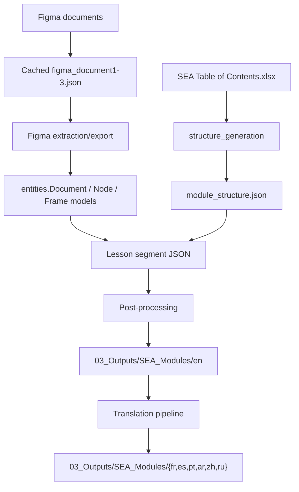
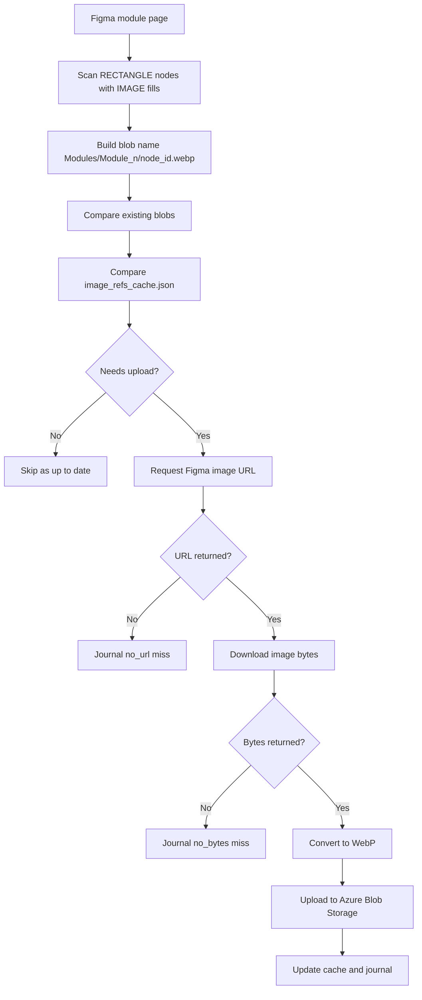
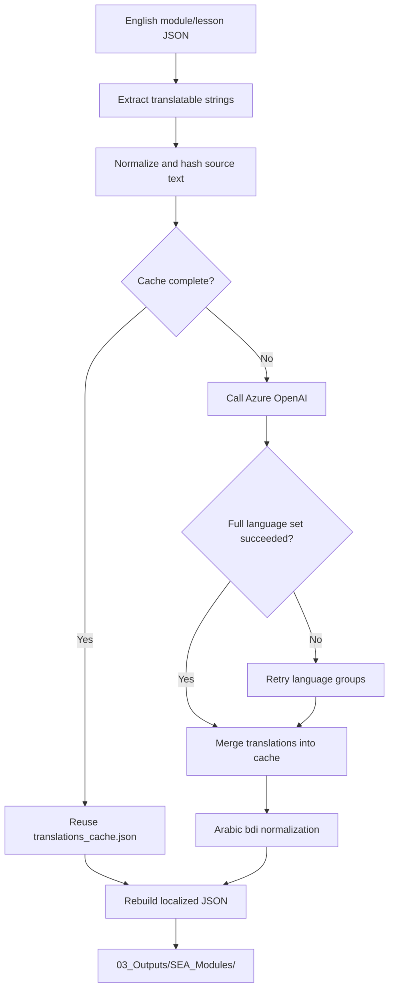
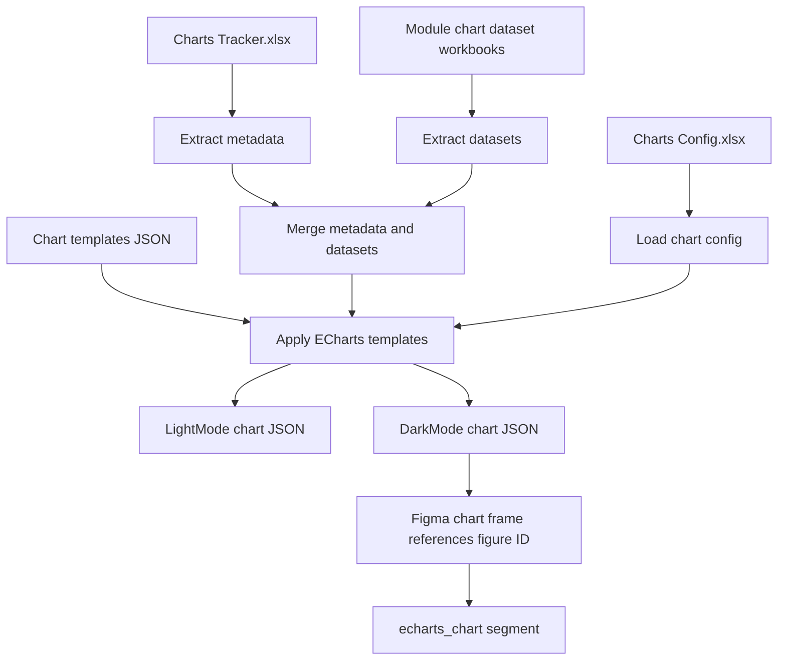
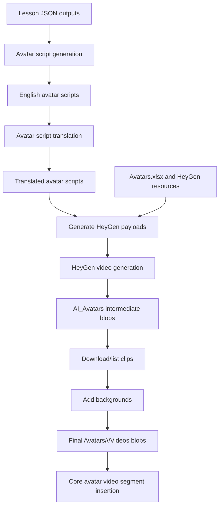
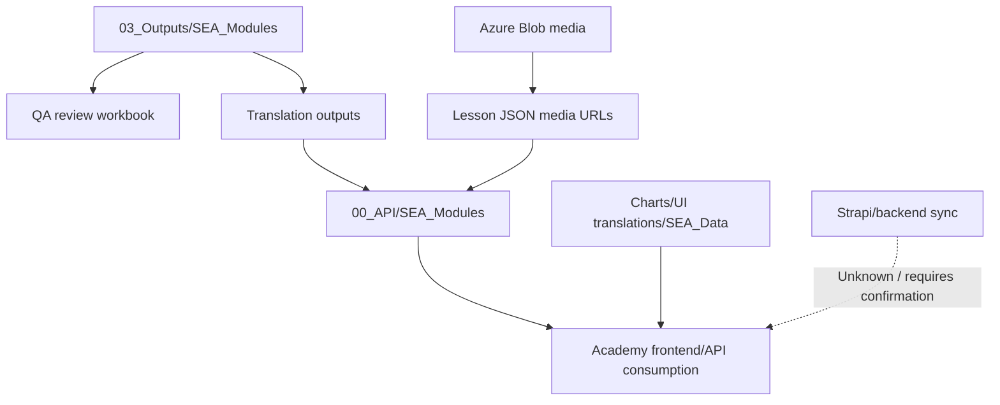

# Academy Pipeline Mermaid Diagrams

## Figma-To-JSON Pipeline

## Image Extraction And Upload Flow

## Translation Flow

## Chart Processing Flow

## AI Avatar Generation Flow

## Academy Publication Flow

